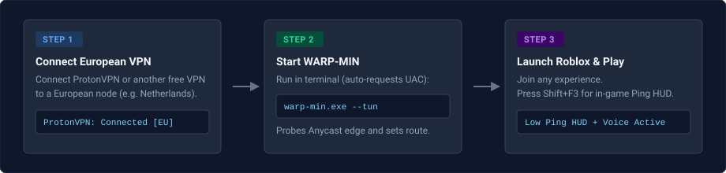
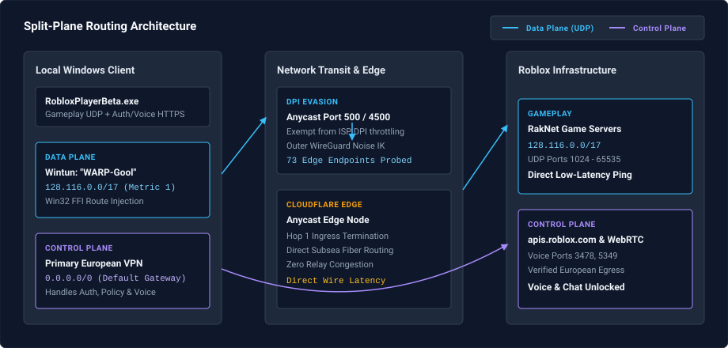

# WARP-MIN

[](https://www.rust-lang.org/)
[](https://www.microsoft.com/windows)
[](https://www.wintun.net/)
[](LICENSE-MIT)
[](https://github.com/Mohannad-Zahra/warp-min/actions)

> **Ultra-Low Latency Standalone Split-Tunneling WireGuard / Cloudflare WARP Client for Windows**  
> Engineered specifically for gamers in restricted network regions to bypass ISP packet inspection, avoid severe VPN ping spikes, and maintain verified voice & text chat in Roblox without full-tunnel routing penalties.

---

## Table of Contents

- [Who Is This For? (Target Audience)](#who-is-this-for-target-audience)
- [The Dilemma: Free VPNs vs. Cloudflare WARP](#the-dilemma-free-vpns-vs-cloudflare-warp)
- [Audience Navigation Hub (Select Your Role)](#audience-navigation-hub)
- [Player & Gamer Guide (Quick Start)](#-player--gamer-guide-quick-start)
  - [3-Step Player Workflow](#3-step-player-workflow)
  - [Roblox Pre-Flight Instructions](#roblox-pre-flight-instructions)
  - [Player FAQ & Common Questions](#player-faq--common-questions)
  - [Wi-Fi Latency Optimization](#wi-fi-latency-optimization)
- [Architectural Solution & Split-Plane Model](#️-architectural-solution--split-plane-model)
  - [Split-Plane Network Diagram (SVG)](#split-plane-network-diagram)
  - [Four Core Technical Innovations](#four-core-technical-innovations)
  - [Key Engine Features](#key-engine-features)
- [Developer & Contributor Guide](#-developer--contributor-guide)
  - [Prerequisites & Toolchains](#prerequisites)
  - [Building from Source](#building-from-source)
  - [Running the Test Suite (57 Tests)](#running-the-test-suite)
  - [Win32 iphlpapi.dll FFI Engine](#win32-iphlpapi-ffi-engine)
- [Technical Specification & LLM Reference](#-llm--technical-specification-reference)
  - [System Invariants & Protocol Specification](#system-invariants--protocol-specification)
  - [Source File Symbol Map](#source-file-symbol-map)
  - [Concurrency and Resource Limits](#concurrency-and-resource-limits)
  - [CLI Reference (All 13 Flags)](#cli-reference)
- [Security, Safety & Audit Disclosure](#-security-safety--audit-disclosure)
  - [UAC Elevation and Cross-MIC IPC](#uac-elevation-and-cross-mic-ipc)
  - [WFP Dynamic Session Lifecycle](#wfp-dynamic-session-lifecycle)
  - [Storage Modification Policy](#storage-modification-policy)
  - [Route and WeakHost Lifecycle](#route-and-weakhost-lifecycle)
  - [WireGuard Identity and Key Safety](#wireguard-identity-and-key-safety)
- [Documentation Index](#documentation-index)
- [License](#license)

---

## Who Is This For? (Target Audience)

WARP-MIN is specifically designed for players who fit into the following situation:

1. **Verified 18+ Account with Voice & Text Chat:**  
   You have an age-verified (+18) Roblox account with spatial voice chat and platform text chat unlocked, but Roblox has been banned, blocked, or heavily restricted by ISPs in your country (e.g. Turkey, Egypt, UAE, etc.).
2. **Frustrated with Free-Tier VPN Latency & Spikes:**  
   When using ProtonVPN or other free-tier VPN services to bypass the country ban, you experience elevated latency, unpredictable jitter, and frequent ping spikes during peak hours or server congestion, making fast-paced gaming sluggish and frustrating.
3. **Muted by Cloudflare WARP:**  
   You tried standard Cloudflare WARP and found your connection latency became much lower and stable, but because Cloudflare WARP retains your local country exit location (`loc=`), Roblox detects your restricted region and locks your in-game voice chat and text chat—leaving you with smooth gameplay but completely muted.
4. **Seeking an Optimal Middle-Ground Solution:**  
   You want the best of both worlds: keeping your existing VPN connected for authentication, launcher, and voice chat egress, while seamlessly split-tunneling Roblox UDP gameplay packets through a low-latency Cloudflare WARP tunnel directly to game servers.

---

## The Dilemma: Free VPNs vs. Cloudflare WARP

For online gamers in restricted regions, choosing how to connect has historically been a lose-lose trade-off:

### Comparative Overview

| Metric / Capability | Free Commercial VPN<br>*(e.g., ProtonVPN Free Tier)* | Raw Cloudflare WARP<br>*(Official 1.1.1.1 Desktop App)* | **WARP-MIN Split-Tunneling**<br>*(Engineered for Competitive Gaming)* |
| :--- | :---: | :---: | :---: |
| **In-Game Gameplay Ping** | Elevated latency / Sluggish | Low wire latency | **Low, direct wire latency** |
| **Ping Jitter & Spikes** | Frequent spikes during congestion / TCP fallback | Minimal jitter | **Consistent & stable UDP routing** |
| **Roblox Spatial Voice Chat** | **Unlocked** *(European exit node)* | **LOCKED** *(Local region detected)* | **Unlocked** *(Split-routed via European VPN)* |
| **Roblox Text & Party Chat** | **Unlocked** *(European exit node)* | **LOCKED** *(Regional policy restriction)* | **Unlocked** *(Split-routed via European VPN)* |
| **ISP Packet Inspection (DPI)** | Flaky *(often falls back to slow TCP/TLS)* | Often blocked on standard ports | **Native DPI bypass** *(UDP Port 500 / 4500)* |
| **Anti-Cheat Integrity** | Safe *(OS-level networking)* | Safe *(OS-level networking)* | **100% Safe** *(Pure Layer-3 Wintun driver; zero memory hooks)* |
| **The Player Experience** | Voice works, but high ping and spikes cause lag | Smooth gameplay, but completely muted | **Low-latency gameplay + fully unlocked voice & chat** |

### How Split-Tunneling Solves the Problem

1. **Why Free VPNs Suffer from Ping Spikes:**  
   Free commercial VPNs encapsulate *all* network traffic across shared, congested European relay servers. In regions where standard WireGuard UDP ports are throttled or dropped, free VPNs fall back to TCP/TLS encapsulation (`WireGuardTls` on port 443). Any dropped packet triggers Head-of-Line (HoL) blocking, stalling subsequent game packets and causing erratic ping spikes and rubber-banding.
2. **Why Raw WARP Leaves Players Muted:**  
   The official Cloudflare 1.1.1.1 application connects to Cloudflare's Anycast edge with low latency, but Cloudflare reports the user's actual geographic origin country. Roblox queries its policy configuration on startup, detects the restricted country, and locks spatial voice and text chat.
3. **The WARP-MIN Hybrid Architecture:**  
   WARP-MIN separates game traffic into two independent network planes:
   - **Data Plane (RakNet UDP `128.116.0.0/17`):** Direct Anycast routing over DPI-exempt UDP ports directly to Roblox game servers, avoiding VPN relay congestion.
   - **Control Plane (Authentication, Voice, & Policies):** Remains routed through your primary European VPN adapter (e.g. ProtonVPN), ensuring Roblox validates European residency and grants full voice and text chat privileges.

---

## Audience Navigation Hub

Select your role to jump directly to the relevant documentation:

| Your Role | What You Care About | Jump Link |
| :--- | :--- | :--- |
| **Player / Gamer** | Quick 3-step setup, running ProtonVPN + WARP-MIN together, in-game verification HUD, and troubleshooting. | [Jump to Player Guide](#-player--gamer-guide-quick-start) |
| **Network Architect** | Split-plane routing, Anycast subsea paths, DPI evasion via UDP 500, and dual-hop encapsulation. | [Jump to Architecture](#️-architectural-solution--split-plane-model) |
| **Developer / Contributor** | Source compilation, toolchain setup, running the 57 tests, Win32 FFI routing, and contributing. | [Jump to Developer Guide](#-developer--contributor-guide) |
| **LLM / AI Scanner** | Unambiguous technical specs, source symbol mappings, bounded channel limits, CLI flags, and protocol invariants. | [Jump to Technical Spec](#-llm--technical-specification-reference) |
| **Security & System Auditor** | UAC elevation scoping, WFP dynamic sessions, Win32 route cleanup, `appStorage.json` safety, and key handling. | [Jump to Security Audit](#-security-safety--audit-disclosure) |

---

## Player & Gamer Guide (Quick Start)

### 3-Step Player Workflow



### Roblox Pre-Flight Instructions

Follow this exact sequence to ensure both low latency and unlocked voice/text chat:

1. **Step 1: Connect Your Free VPN**  
   Open your VPN application (e.g., ProtonVPN) and connect to a European server (such as the Netherlands, Germany, or Italy). Verify that your web browser shows European exit.
2. **Step 2: Start WARP-MIN**  
   Launch `warp-min.exe --tun` in PowerShell or Windows Terminal (or double-click the executable). If prompted by Windows User Account Control (UAC), click **Yes**.  
   Within ~1.5 seconds, WARP-MIN probes Anycast endpoints, installs the Wintun adapter, and establishes the tunnel:
   ```text
   [+] Hop 1 Handshake established with 162.159.192.1:500!
   [+] Hop 2 Handshake established with 188.114.97.3:2408!
   [+] Pure Split-Tunneling active: Roblox gameplay UDP routes via WARP-Gool (128.116.0.0/17)
   ```
3. **Step 3: Launch Roblox & Play**  
   Launch `RobloxPlayerBeta.exe` and join your desired game.  
   - Press **Shift + F3** in-game to view the live Roblox Network HUD.  
   - You will see direct, stable wire ping without VPN relay latency.  
   - Your spatial voice chat and in-game text chat will remain fully functional through your European VPN session.

### Player FAQ & Common Questions

<details>
<summary><b>Q1: Do I have to keep ProtonVPN running while playing?</b></summary>
<p>
Yes. Roblox checks your IP when authenticating to <code>apis.roblox.com</code> and when initializing WebRTC voice streams on ports 3478 and 5349. Because WARP-MIN only redirects gameplay traffic (<code>128.116.0.0/17</code>), your VPN must remain connected in the background to handle authentication and keep your voice chat unlocked.
</p>
</details>

<details>
<summary><b>Q2: Will using WARP-MIN get my Roblox account banned?</b></summary>
<p>
No. WARP-MIN operates purely at Layer 3 of the Windows networking stack using the official, signed WireGuard Wintun driver. It does not touch, inject into, hook, or inspect the Roblox process memory, making it 100% compliant with Roblox's Byfron / Hyperion anti-cheat.
</p>
</details>

<details>
<summary><b>Q3: What should I do if Roblox shows Error 279 (Connection Attempt Failed)?</b></summary>
<p>
Error 279 typically happens when a commercial VPN's kill-switch blocks local network packets. WARP-MIN automatically installs a high-priority Windows Filtering Platform (WFP) permit rule for the <code>WARP-Gool</code> adapter to prevent this. If you encounter issues, run <code>warp-min.exe --diagnose</code> to execute an automated 6-stage self-test.
</p>
</details>

<details>
<summary><b>Q4: What happens if I close WARP-MIN with Ctrl+C?</b></summary>
<p>
WARP-MIN registers clean shutdown handlers. Upon exit, it automatically deletes all injected host routes, unmounts the Wintun adapter, restores your physical adapter's WeakHost settings, and terminates its dynamic WFP filter session. No residual routes are left behind.
</p>
</details>

### Wi-Fi Latency Optimization

If playing over Wi-Fi, Windows AutoConfig (`WlanSvc`) scans for surrounding SSIDs every 60 seconds by default, causing momentary periodic ping spikes.

To temporarily disable background scanning while gaming:
```cmd
:: Run as Administrator in Command Prompt or PowerShell:
netsh wlan set autoconfig enabled=no interface="Wi-Fi"
```

To re-enable scanning when switching networks:
```cmd
netsh wlan set autoconfig enabled=yes interface="Wi-Fi"
```

---

## Architectural Solution & Split-Plane Model

### Split-Plane Network Diagram



### Four Core Technical Innovations

1. **Direct Mediterranean Subsea Ingestion:**  
   Connects directly to Cloudflare's nearest Anycast edge nodes, taking the shortest physical transit path across regional subsea cables rather than detouring through congested commercial VPN server clusters.
2. **DPI Evasion via Privileged Anycast Ports (500 / 4500):**  
   Routes the outer WireGuard tunnel through UDP port 500 (standard IKEv2 / IPsec) or port 4500 (IPsec NAT-T). Because banking systems, government portals, and corporate IPsec tunnels rely on port 500, ISP middleboxes exempt these ports from heuristic throttling and WireGuard packet dropping.
3. **Dual-Hop WireGuard ("Gool") Architecture:**  
   Supports nested WireGuard encapsulation (Hop 2 inside Hop 1) to land egress traffic inside European Anycast pools (`loc=IT` / `loc=DE`).
4. **Split-Plane Kernel Routing:**  
   Rather than routing all system traffic through the tunnel, WARP-MIN strictly routes **RakNet UDP gameplay traffic (`128.116.0.0/17`)** through the dedicated Wintun adapter (`WARP-Gool`), while keeping Roblox control-plane HTTPS APIs (`apis.roblox.com`) and voice WebRTC traffic on your primary VPN adapter.

### Key Engine Features

- **Pure Rust Implementation:** Built with Tokio, BoringTun (Cloudflare's Noise protocol implementation), and Wintun. Zero external batch scripts or unmanaged utilities.
- **Native Win32 FFI Routing:** Replaced PowerShell and `netsh` subprocess calls with direct Win32 `iphlpapi.dll` calls (`CreateIpForwardEntry2`, `DeleteIpForwardEntry2`, `GetBestRoute2`), dropping route setup and teardown latency from ~3.5 seconds to under 10 milliseconds.
- **Wintun Kernel Layer-3 Driver:** Operates directly on the high-speed Wintun TUN driver with 8 MB zero-copy circular ring buffers and 4 MB OS UDP socket buffers.
- **Windows Filtering Platform (WFP) Hard-Permit Subsystem:** Installs a maximum-priority dynamic WFP sublayer and hard-permit filters (`FWPM_FILTER_FLAG_CLEAR_ACTION_RIGHT`) scoped strictly to the Wintun adapter LUID. Enables seamless coexistence with primary VPN kill-switches (e.g. ProtonVPN) without packet drops at `ALE_AUTH_CONNECT_V4` (eliminating Roblox Error 279).
- **TCP MSS Clamping (RFC 1624):** Automatically clamps TCP MSS to 1120 bytes on `SYN`/`SYN-ACK` packets with incremental 16-bit 1's complement checksum updates to prevent MTU black holes.
- **Dynamic Anycast Probing:** Probes 73 candidate Cloudflare Anycast endpoints in parallel at startup, locking into the lowest-latency responsive edge server.
- **Rolling Log Rotation:** Features dual-sink structured logging with a 10 MB rolling file limit and automatic `.1` backup rotation to prevent unbounded disk growth.
- **Safety-First Storage Protection:** Modifying Roblox's `appStorage.json` is strictly opt-in via `--patch-storage` and automatically creates an `appStorage.json.bak` safety backup before any modification.

---

## Developer & Contributor Guide

### Prerequisites

- **Operating System:** Windows 10 or Windows 11 (64-bit).
- **Rust Toolchain:** Rust 1.85+ (Edition 2024 compatible) with either:
  - `x86_64-pc-windows-gnu` (MinGW-w64 / GCC via `w64devkit`)
  - `x86_64-pc-windows-msvc` (Visual Studio Build Tools)
- **Wintun Driver:** `wintun.dll` (WireGuard LLC official signed driver, included in the repository root and bundled via `build.rs`).
- **Privileges:** Windows Administrator token required for testing Wintun adapter initialization and kernel route table manipulation.

### Building from Source

```powershell
# Clone the repository
git clone https://github.com/Mohannad-Zahra/warp-min.git
cd warp-min

# Build optimized release binary
cargo build --release

# Format verification
cargo fmt --check

# Strict linting (zero warnings enforced)
cargo clippy --all-targets -- -D warnings
```

The compiled binary will be located at `target\release\warp-min.exe`.

### Running the Test Suite

WARP-MIN contains **57 unit and integration tests** organized into dedicated component modules under `src/test/`:

```powershell
# Run the complete test suite
cargo test --release
```

All 57 tests run in parallel in ~0.8s without mutating global system state or leaving dirty network routes.

### Win32 iphlpapi FFI Engine

Earlier prototype implementations spawned `powershell.exe` or `netsh.exe` subprocesses to add and delete routes. This introduced ~3.5 seconds of process startup overhead and left lingering routes if the process was terminated abruptly.

WARP-MIN v1.1.0 communicates directly with the Windows TCP/IP kernel via `iphlpapi.dll`:
- **`GetBestRoute2` & `ConvertInterfaceLuidToAlias`:** Resolves physical and VPN adapter indices and interface LUIDs in microseconds.
- **`CreateIpForwardEntry2`:** Injects the `/17` RakNet gameplay subnet (`128.116.0.0/17`) with metric 1 directly into the kernel routing table.
- **`DeleteIpForwardEntry2`:** Guarantees instantaneous route revocation upon tunnel drop.
- **`GetIpInterfaceEntry` & `SetIpInterfaceEntry`:** Inspects and toggles `WeakHostSend` and `WeakHostReceive`, with complete restoration of original adapter flags upon shutdown.

---

## Technical Specification & LLM Reference

> [!NOTE]  
> This section is formatted for automated repository scanners, LLM agents, and technical analyzers to provide unambiguous architectural facts, constraints, and data flows.

### System Invariants & Protocol Specification

1. **Routing Invariant:**  
   The `128.116.0.0/17` CIDR covers all Roblox RakNet UDP game servers (`128.116.0.0` to `128.116.127.255`). It is routed exclusively through `WARP-Gool` (Wintun L3). All other traffic—specifically HTTPS requests to `apis.roblox.com` (Control Plane) and WebRTC STUN/SRTP packets on UDP ports `3478` and `5349` (Voice)—remains on the primary default gateway (European VPN).
2. **WireGuard Handshake:**  
   Noise IK pattern over Curve25519 (`x25519-dalek`), ChaCha20Poly1305, and BLAKE2s. Hop 1 targets Cloudflare Anycast on UDP port 500 or 4500. Hop 2 is nested inside Hop 1 payload targeting Endpoint B on UDP port 2408.
3. **MSS Clamping:**  
   TCP `SYN` and `SYN-ACK` packets traversing the tunnel are clamped to MSS `1120` bytes via RFC 1624 incremental 1's complement checksum updates to prevent PMTU black holes.
4. **SNAT Router:**  
   Bidirectional 1:N Source NAT maps local client ephemeral ports to tunnel internal IPv4 (`172.16.0.2`), with bounded FIFO queue eviction capped at 2048 entries.

### Source File Symbol Map

| Source Path | Primary Module | Core Responsibilities |
| :--- | :--- | :--- |
| [`src/main.rs`](src/main.rs) | `main` | CLI parsing (`Args`), Anycast probing orchestration, handshake health gate, diagnostic suite, application lifecycle. |
| [`src/tunnel.rs`](src/tunnel.rs) | `tunnel` | Dual-hop BoringTun encapsulation/decapsulation, RFC 1624 MSS clamping, SNAT map, packet classifiers (`is_roblox_gameplay_udp`, `is_roblox_control_plane_tcp`, `is_roblox_voice_traffic`). |
| [`src/tun.rs`](src/tun.rs) | `tun` | Wintun adapter lifecycle, native Win32 `iphlpapi.dll` route table manipulation (`CreateIpForwardEntry2`, `DeleteIpForwardEntry2`), WeakHost management and state restoration. |
| [`src/socks.rs`](src/socks.rs) | `socks` | smoltcp user-space TCP/IP netstack, SOCKS5 proxy server, adaptive polling timer (100ms idle / 5ms active). |
| [`src/api.rs`](src/api.rs) | `api` | Ephemeral Curve25519 keypair generation, Cloudflare WARP registration API client via async `reqwest` (with SOCKS5 proxy support). |
| [`src/elevate.rs`](src/elevate.rs) | `elevate` | Windows token elevation check, UAC relaunch (`runas`), SDDL-hardened cross-MIC Named Event IPC, Windows command-line argument quoting. |
| [`src/logger.rs`](src/logger.rs) | `logger` | Dual-sink structured logger (Console + file), ISO 8601 timestamps via `chrono`, 10 MB rolling file rotation with `.1` rollover. |
| [`src/wfp.rs`](src/wfp.rs) | `wfp` | Dynamic Windows Filtering Platform (WFP) session management, high-priority hard-permit filter installation (`ALE_AUTH_CONNECT_V4`, `ALE_AUTH_RECV_ACCEPT_V4`). |
| [`src/dns.rs`](src/dns.rs) | `dns` | RFC 1035 wire-format DNS query serializer and response parser with CNAME and 14-bit compression pointer resolution. |
| [`src/test/`](src/test/) | `test` | Dedicated unit and integration tests across 7 component directories: `anycast`, `cli`, `elevate`, `policy`, `routing`, `tunnel`, `wfp`. |

### Concurrency and Resource Limits

- **Task Channels:** All inter-task communication uses bounded Tokio channels (`mpsc::channel(2048)`). No unbounded channels exist.
- **Wintun Ingress:** Packet read thread uses `blocking_send` into the 2048-packet bounded queue, providing natural backpressure to Wintun's 8 MB circular ring buffer.
- **SNAT State:** Capped at 2048 concurrent port mappings with FIFO eviction (`snat_order`).
- **File Logging:** Capped at 10 MB per file with automatic rotation to `warp-min.log.1`.

### CLI Reference

```text
Usage: warp-min.exe [OPTIONS]

Options:
      --tun                    Enable Wintun adapter mode ('WARP-Gool') with split-tunneling [default]
      --socks                  Enable SOCKS5 proxy fallback mode
      --bind <BIND>            Bind address for SOCKS5 proxy mode [default: 127.0.0.1:8086]
      --endpoint-a <ADDR>      Cloudflare outer Anycast endpoint A [default: 162.159.192.1:500]
      --endpoint-b <ADDR>      Cloudflare inner Anycast endpoint B [default: 188.114.97.3:2408]
      --single                 Single-hop direct WARP mode (outer tunnel only)
      --register-hop2          Re-register Hop 2 identity through SOCKS5 proxy to obtain European GeoIP
      --patch-storage          Opt-in modification of Roblox appStorage.json to unblock chat policies (creates .bak backup)
      --log-file <PATH>        Path to persistent diagnostic log file [default: warp-min.log]
      --no-log-file            Disable writing persistent log file to disk
      --log-level <LEVEL>      Structured logging level (debug, info, warn, error) [default: info]
      --diagnose               Run automated end-to-end diagnostic suite (validates routing, adapter, and handshakes)
      --log-packets            Enable individual packet flow tracing (RakNet, STUN/Voice, Control)
  -v, --verbose                Enable verbose / debug logging
  -h, --help                   Print help
  -V, --version                Print version
```

---

## Security, Safety & Audit Disclosure

### UAC Elevation and Cross-MIC IPC

- **Why Elevation is Required:** Creating a Layer-3 Wintun network adapter and modifying the Windows kernel IP routing table (`iphlpapi.dll`) require administrative permissions (`SE_LOAD_DRIVER_PRIVILEGE` and network configuration operators rights).
- **Auto-Elevation Safety:** When launched non-elevated in TUN mode, `relaunch_elevated` initiates a standard Windows UAC prompt (`runas`). The arguments are safely quoted via `quote_win_arg` according to Microsoft parsing rules.
- **Cross-MIC Named Event Security:** To allow a Medium-Integrity parent process to signal shutdown to the High-Integrity elevated child, a Named Event (`Global\WARP_MIN_SHUTDOWN_<pid>`) is created with an explicit SDDL:
  ```text
  D:(A;;GA;;;BA)(A;;GA;;;SY)(A;;0x00100002;;;IU)S:(ML;;NW;;;ME)
  ```
  - **DACL:** Restricts full control (`GA`) to Built-in Administrators (`BA`) and LocalSystem (`SY`). Interactive Console Users (`IU`) receive strictly `SYNCHRONIZE | EVENT_MODIFY_STATE` (`0x00100002`), allowing signal transmission without granting ownership or modification rights.
  - **SACL:** Specifies Mandatory Integrity Label Medium (`ME`) with No-Write-Up (`NW`), enabling cross-integrity shutdown signaling while blocking unauthorized remote or network callers.

### WFP Dynamic Session Lifecycle

- All Windows Filtering Platform (WFP) permit filters are installed within a **Dynamic Session** (`FWPM_SESSION_FLAG_DYNAMIC`).
- By Windows kernel design, if the `warp-min` process terminates unexpectedly, crashes, or is killed by Task Manager, Windows automatically tears down the dynamic session and de-registers all associated filters, guaranteeing no persistent security holes.
- Hard-permit filters are scoped strictly to the LUID of the `WARP-Gool` adapter (`FWPM_CONDITION_IP_LOCAL_INTERFACE`). They do not weaken firewall policies on your Wi-Fi, Ethernet, or commercial VPN interfaces.

### Storage Modification Policy

- By default, WARP-MIN performs **zero modifications** to `%LOCALAPPDATA%\Roblox\LocalStorage\appStorage.json`.
- Policy modification is strictly opt-in via `--patch-storage`. When enabled, WARP-MIN creates an `appStorage.json.bak` copy prior to any write.
- Diagnostic mode verifies file presence and read/write availability without altering policy data.

### Route and WeakHost Lifecycle

- Injected routes are scoped to `128.116.0.0/17`.
- On shutdown, `TunState::restore_routing` deletes injected routes via `DeleteIpForwardEntry2`.
- The physical adapter's initial `WeakHostSend` and `WeakHostReceive` states are queried at startup and restored exactly to their original values upon exit.

### WireGuard Identity and Key Safety

- Cloudflare WARP account identities are generated via Curve25519 ephemeral keys and saved locally in `warp_identity_hop1.json` and `warp_identity_hop2.json`.
- These files are stored in the application directory and are strictly excluded from version control via `.gitignore`. Users should treat these files as confidential credentials and avoid sharing them.
- No telemetry, analytics, or background telemetry services are bundled or contacted.

---

## Documentation Index

For in-depth architectural analyses and engineering specifications, refer to the documentation in `docs/` and `future_work/`:

- **[Architecture & Split-Plane Network Model](docs/architecture-and-split-plane-network-model.md)**
- **[Deep Packet Inspection (DPI) & Anycast Port 500 Bypass](docs/dpi-and-anycast-port-500-bypass.md)**
- **[Roblox Protocol Analysis](docs/roblox-protocol-analysis.md)**
- **[Windows Kernel Routing & WLAN Optimization](docs/windows-kernel-routing-and-wlan-optimization.md)**
- **[Troubleshooting & Verification Guide](docs/troubleshooting-and-verification-guide.md)**
- **[Future Work & Engineering Roadmap](future_work/README.md)** (Blueprints 01-06: Standalone EU Hop 2, Tray GUI, CI/CD, Voice Sniffing, Diagnostics, Ping Stability)

---

## License

This project is licensed under the standard Rust ecosystem dual-license structure: you may choose either the [MIT License](LICENSE-MIT) or the [Apache License 2.0](LICENSE-APACHE) at your option.
