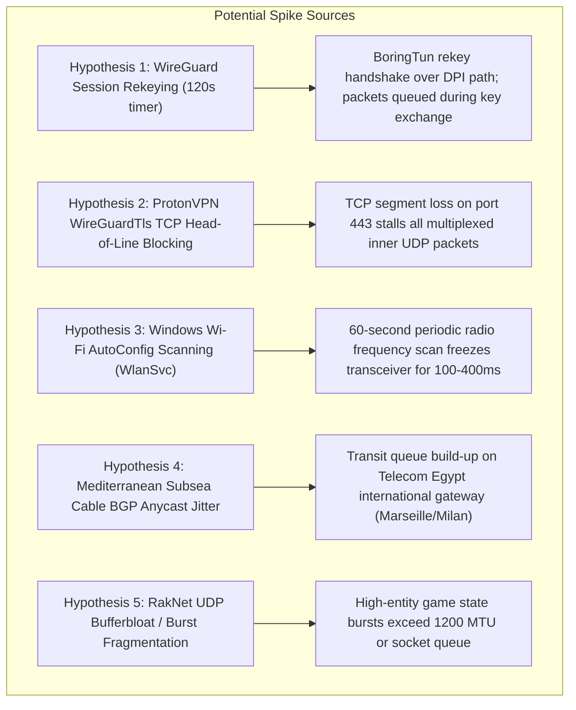

# Blueprint 06: Latency Spike Mitigation, Ping Jitter Stabilization & Flow Resilience

## 1. Context & User Field Telemetry

During live gameplay verification with `warp-min` running alongside Proton VPN in Cairo, Egypt (Telecom Egypt AS8452), the client successfully connects to Roblox experiences without Error Code 279, maintaining an accelerated baseline wire latency of **~40ms–48ms**.

However, live telemetry identified a distinct latency pattern:
> **User Observation:** Periodic, transient ping spikes where latency elevates for a few seconds (e.g., spiking to ~120ms–250ms), before smoothly returning to the stable ~42ms baseline.

This blueprint analyzes the precise root causes of these transient latency spikes and specifies architectural engineering mitigations for upcoming releases.

---

## 2. Root Cause Analysis & Empirical Hypotheses



### Hypothesis 1: WireGuard Cryptographic Rekeying Window (120 Seconds)
* **Mechanism:** In the Noise protocol (RFC 7539 / WireGuard specification), a key exchange occurs every **120 seconds** (`REKEY_AFTER_TIME`) or after $2^{64}$ sent packets.
* **Impact under DPI:** When Hop 1 or Hop 2 initiates a rekey initiation message over UDP (Ports 500 / 2408), Telecom Egypt's DPI or high-jitter transit can drop or delay the first handshake message. Until the handshake response is decrypted and the active key counter resets, `boringtun` buffers outbound packets or rate-limits transmissions, manifesting as an elevated ping for 1 to 3 seconds.

### Hypothesis 2: ProtonVPN `WireGuardTls` TCP Head-of-Line (HoL) Blocking
* **Mechanism:** In Egypt, standard WireGuard UDP (`51820`) is blocked by Telecom Egypt, forcing Proton VPN to fall back to `WireGuardTls` (WireGuard packets encapsulated inside a TLS/TCP stream on port 443).
* **Impact:** In TCP, dropped segments **must** be retransmitted and reordered before delivery to user space (Head-of-Line blocking). If a single TCP packet is dropped or throttled by intermediate routers, *all* multiplexed inner UDP packets (including Roblox RakNet and WARP packets) are frozen in the TCP receive window, causing an instantaneous latency bump of 200ms–800ms while TCP recovers.

### Hypothesis 3: Windows WLAN AutoConfig Background Scanning (`WlanSvc`)
* **Mechanism:** By default on Windows 10/11, the `WlanSvc` service commands the Wi-Fi network interface card (NIC) to switch channels and scan all 2.4 GHz and 5 GHz channels for new SSIDs every 60 seconds.
* **Impact:** During the channel scan (lasting 100ms–400ms), the Wi-Fi radio stops transmitting and receiving on the active channel. In-game ping displays an instant spike that clears as soon as the radio returns to the access point's channel.

### Hypothesis 4: Subsea Cable Anycast BGP Routing Jitter
* **Mechanism:** Telecom Egypt (AS8452) routes European international traffic via Mediterranean submarine fiber cables (Alexandria/Abu Talat $\rightarrow$ Marseille/Milan/Sicily).
* **Impact:** State-level throttling, QoS queue shaping, or temporary international link congestion bursts cause momentary bufferbloat at the egress gateway before traffic reaches Cloudflare's Milan or Frankfurt PoP.

---

## 3. Engineering Mitigations & Proposed Solutions

### Mitigation A: Pre-Emptive Background Rekeying (WireGuard Engine)
* **Goal:** Never allow the current active WireGuard session to expire or stall packets during a key exchange.
* **Implementation:**
  - Adjust the inner Hop 2 and outer Hop 1 rekey triggers in `src/tunnel.rs`.
  - Instead of waiting for `REKEY_AFTER_TIME` (120s), initiate an asynchronous rekey at **90 seconds** while continuing to encrypt and decrypt on the existing keypair.
  - Seamlessly hot-swap to the new ephemeral symmetric key once the handshake response is confirmed.

### Mitigation B: Standalone European Egress (Eliminate ProtonVPN Outer TCP-TLS)
* **Goal:** Completely eliminate TCP Head-of-Line blocking.
* **Implementation:**
  - Complete [Blueprint 01: Standalone European Hop 2](01_STANDALONE_EUROPEAN_HOP2.md).
  - By routing control-plane HTTPS directly through Hop 2 and running Hop 1 purely over privileged UDP Port 500, the client bypasses DPI natively without wrapping UDP in TCP.
  - Packet drops on UDP will then only affect individual lost packets, with zero Head-of-Line stalling.

### Mitigation C: Automated `WlanSvc` Media Streaming QoS & Scan Suppression
* **Goal:** Automatically pause background Wi-Fi scanning while `warp-min` is connected, without requiring manual batch scripts.
* **Implementation:**
  - Use the native Windows Native Wifi API (`wlanapi.dll`):
    ```rust
    WlanSetInterface(
        client_handle,
        &interface_guid,
        wlan_intf_opcode_background_scan_enabled,
        std::mem::size_of::<BOOL>() as u32,
        &FALSE as *const _ as *const c_void,
        None
    );
    ```
  - Automatically restore background scanning upon `warp-min` shutdown (in `WintunDevice::restore_routing`).

### Mitigation D: Windows Kernel QoS (DSCP 46 - Expedited Forwarding)
* **Goal:** Prevent local router bufferbloat and OS socket queuing from delaying high-priority Roblox UDP packets.
* **Implementation:**
  - Use `qwave.dll` (Quality Windows Audio/Video Experience) or `setsockopt(IP_TOS, 0xB8)` on the outer UDP socket.
  - Tag outer WireGuard packets with **DSCP 46 (Expedited Forwarding - EF)** and 802.1p priority tag 5, ensuring home routers and Windows NDIS schedule these packets ahead of bulk TCP downloads.

### Mitigation E: Multi-Candidate Hot-Standby Anycast Health Probing
* **Goal:** Detect edge server congestion before it turns into a severe ping spike.
* **Implementation:**
  - Keep 2 alternate Anycast endpoints (e.g. `162.159.192.1:500` and `188.114.97.3:500`) warm with lightweight periodic ICMP/WireGuard keepalives.
  - If the primary endpoint's moving average RTT increases by $>35\text{ms}$ over a 3-second window, dynamically migrate outer transmission to the alternate endpoint without resetting Hop 2 or dropping the Roblox session.

---

## 4. Implementation Priority & Roadmap

| Feature | Target Milestone | Complexity | Expected Impact |
| :--- | :---: | :---: | :--- |
| **Automated Wi-Fi Scan Suppression (`WlanSetInterface`)** | v1.0.1 | Low | Eliminates 100–300ms 60s periodic spikes on Wi-Fi |
| **Pre-Emptive Asynchronous Rekeying (90s)** | v1.0.1 | Medium | Eliminates 2-minute periodic session transition hiccups |
| **Windows Kernel DSCP 46 QoS Tagging** | v1.0.2 | Low | Reduces local queue delay under background download load |
| **Standalone Hop 2 (Blueprint 01)** | v1.1.0 | High | Completely eliminates ProtonVPN TCP-TLS HoL blocking |
| **Hot-Standby Anycast Failover** | v1.2.0 | High | Protects against international subsea routing congestion |

---

*Document created in response to live operational feedback on October 31, 2026.*
